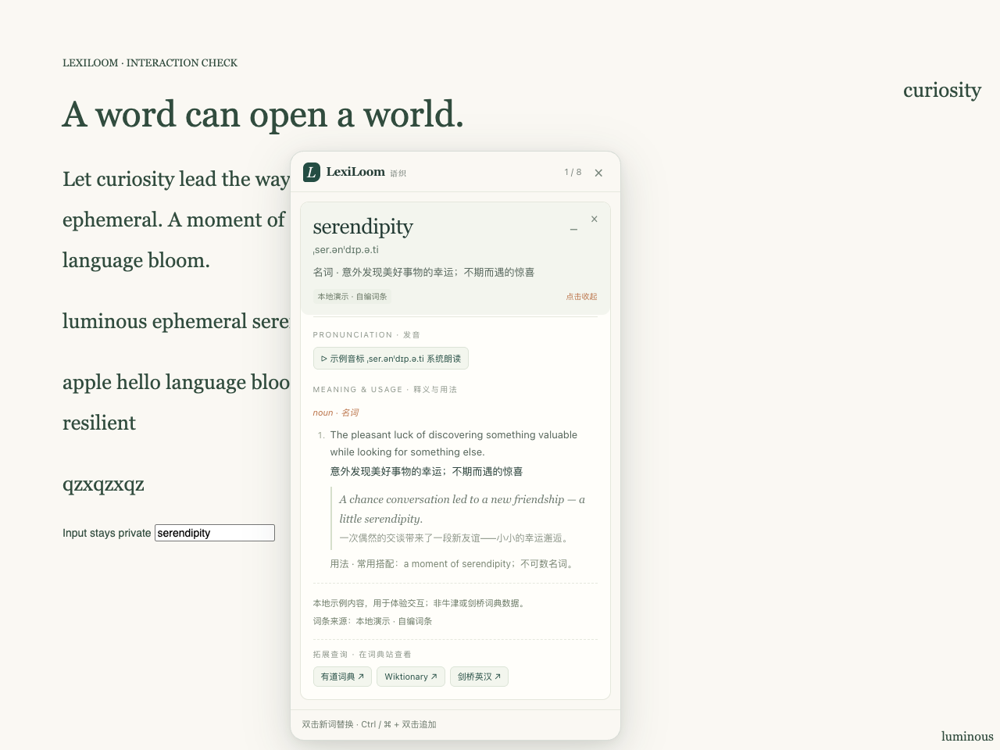

# LexiLoom

[中文](README.md)

Look up a word without leaving the page. Double-click an English word. For Chinese, select the word and click the small lookup button. A short definition shows up beside the text; open the card for pronunciation, usage and examples. Several cards can stay on the page, and each one opens on its own.



## Install

Chrome 140 or newer. The same extension runs on Windows, macOS and Linux. There is nothing to compile.

1. Download the source, or unzip `dist/LexiLoom-<version>-chrome.zip`.
2. Open `chrome://extensions` and turn on Developer mode.
3. Choose Load unpacked. For a source checkout, pick the `extension` folder. It has to contain `manifest.json`.
4. Refresh pages that were already open.

The toolbar icon opens settings, and a page where you can try the cards before reading anything.

Packaging also writes a `-store.zip` with `manifest.json` at the root for a future store submission.

## Use

Click a headword to open the card, and click it again to close it. Hold Ctrl (⌘ on a Mac) and double-click another word to add it to the same group, up to 8. The × on a card removes that word. The × at the top, Esc, or a click on empty page closes the whole group.

If the dictionary has a recording, the card plays it. Otherwise it uses the browser's own voice.

Chinese and English use the same card. The interface follows Chrome's language. A Chinese lookup shows the reading for that region, one or two examples, and an English explanation. If the source left something out, the card says so.

- Simplified Chinese, mainland China: simplified definitions and Hanyu Pinyin.
- Traditional Chinese, Taiwan: a Taiwan entry and Zhuyin. The wording is the Ministry of Education text.
- Traditional Chinese, Hong Kong: traditional definitions, with Jyutping that the source marks as Hong Kong. A Mandarin reading, when there is one, is labeled as a supplement.

OpenCC only changes how Wiktionary text is displayed and which spelling is searched. A mainland entry with its characters converted is still a mainland entry. If Chrome only offers one Traditional Chinese and cannot tell Hong Kong from Taiwan, pick the region in settings.

Some simplified characters have several traditional counterparts. For a character such as “干”, the card keeps the original lookup and names the converted spelling it also checked. This does not cover every possible sense; selecting a complete word gives more context.

In the English interface, an English word shows the English definition, pronunciation and examples. A Chinese word still keeps its Chinese spelling and reading.

Chrome's own pages, the extension store, the built-in PDF viewer, text fields, editors and iframes are not covered yet.

## Where the words come from

The defaults need no API key.

In a Chinese interface, an English word tries Chinese Wiktionary first and then Free Dictionary. The card names the source and says when it had to fall back. In an English interface, an English word uses Free Dictionary.

Chinese words follow the region:

- Mainland definitions, and the Wiktionary readings, come through [WiktApi](https://wiktapi.dev/).
- Taiwan definitions and Zhuyin come first from the Ministry of Education dictionary on Moedict.
- Hong Kong prefers a Wiktionary reading marked Cantonese and Hong Kong.
- The English explanation comes from the Chinese entry in English Wiktionary.
- [Free Dictionary](https://dictionaryapi.dev/) supplies the English definition and audio for English words.
- Oxford and Cambridge are optional. They need your own official access and the local dictionary service. See [bridge/README.en.md](bridge/README.en.md).
- The English demo entries are written for this project. The Chinese practice section uses online dictionaries.

Source links, example references and license links stay at the bottom of the card. Coverage differs by dictionary. Attribution is in [THIRD_PARTY.en.md](THIRD_PARTY.en.md). A lookup sends the word you selected. It does not upload the page or keep a history. See [Privacy](PRIVACY.en.md).

## Dictionary link directory

An expanded card lists up to three dictionary links you can open. They are chosen by headword language, dictionary region and interface language. They take you to the dictionary site and do not replace the card's own source:

- Chinese headwords: Chinese Wiktionary, Han Dian (汉典), Moedict, Words.hk (粤典), Youdao, Baidu Hanyu.
- English headwords: Wiktionary, Oxford Learner's Dictionaries, Cambridge, Merriam-Webster, Youdao, Bing Dictionary, Cambridge English–Chinese.

Region and interface language filter the list. A Hong Kong headword prefers Words.hk and the Traditional Han Dian entry, a Taiwan headword prefers Moedict, and a mainland headword prefers the simplified Han Dian entry. Youdao, Bing and Cambridge English–Chinese can appear when a Chinese interface looks up an English word; an English interface keeps English-only sites. At most three links are taken by priority, so disabling a site or adding a custom template changes the result.

Open **Dictionary navigation** from the toolbar popup or the bottom of a card to see every matching site. Enter a headword and choose Chinese, English, Japanese, Korean, French, German or Spanish explicitly. Japanese and Korean offer their own Wiktionary; French also has Larousse, German Duden, and Spanish RAE. Case, accents and spelling stay as entered.

Japanese, Korean, French, German and Spanish also have webpage word cards. Choose the word language in the toolbar popup or settings, then double-click or select a word. These cards currently show **Simplified Chinese definitions**, including in an English interface. Original headwords, case and source-language examples stay unchanged; speech uses the source language and examples are limited to two.

The source is Chinese Wiktionary through WiktApi. Missing Chinese definitions, readings and examples are identified separately from an absent word or a service failure. Switching back to automatic Chinese/English mode retains your previous sources and Chinese region. Japanese/Korean words allow up to 32 characters; the other supported words allow 48. Sentence translation is not included.

The navigation page has its own language selector. It remains useful when a card lacks Chinese coverage; its links do not confirm that a site contains the headword.

Settings can turn each built-in site off and add up to six custom templates. `Name | https://…/{word}` applies to all languages; `fr | Name | https://…/{word}` applies only to French. Other codes are `en`, `zh`, `ja`, `ko`, `de` and `es`. Templates require HTTPS, with `{word}` in the path, query or fragment. Names are limited to 60 characters and URLs to 300. Invalid or oversized entries reject the save without truncating or dropping rows.

The directory only generates links. The extension does not fetch or rehost those pages, and it adds no host permissions for them: the manifest still lists only local storage and the same four lookup hosts. Opening a link takes you to the destination site's own content and policies. Card content always comes from the sources in "Where the words come from"; these links are extra entry points.

## Development

Node.js 22 or newer. The extension loads on its own and includes OpenCC. The local service and packager need no npm runtime dependencies. Playwright is for the browser tests.

```sh
npm ci
npm test
npm run check
npm run preview   # http://127.0.0.1:4173
npm run package   # writes to dist/
```

Browser tests:

```sh
npx --no-install playwright-core install chromium
npm run test:browser
npm run test:browser:locales
npm run test:browser:ui
npm run test:browser:navigation
npm run test:browser:multilingual
```

For optional real-service verification, run `npm run test:browser:multilingual:live`. It queries five sample words through the installed extension and is kept out of default CI because network and corpus availability can change.

On Linux, install Chromium with `install --with-deps chromium`. Tests use fixed samples unless you set `LEXILOOM_LIVE_TESTS=1`.

Launchers and CI are in the [cross-platform notes](docs/CROSS_PLATFORM.en.md). Recorded results are in [docs/VALIDATION.md](docs/VALIDATION.md). The [architecture notes](docs/ARCHITECTURE.en.md) describe language profiles, adapters and the card contract. Release notes are in [CHANGELOG.en.md](CHANGELOG.en.md).

## License

Code, styles, sample entries and these notes are [MIT](LICENSE), copyright lightporta. Dictionary text, quotations and audio keep their own licenses. See [THIRD_PARTY.en.md](THIRD_PARTY.en.md).
