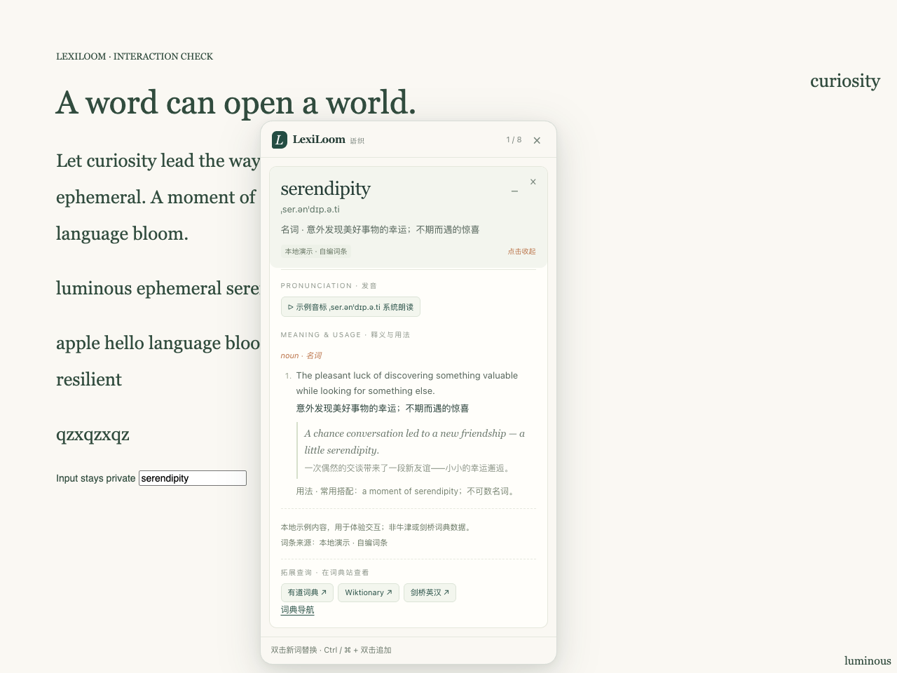

# LexiLoom · 语织

[English](README.en.md)

在网页里查单词。英文双击一下，中文划一下再点旁边的查词。意思先出现在旁边的小卡片上，点开才是读音、用法和例句。一次可以留好几张卡，各自展开，互不打扰。



## 安装

Chrome 140 或更新版本。Windows、macOS、Linux 用同一份扩展，不用编译。

1. 下载源码，或把 `dist/LexiLoom-<版本>-chrome.zip` 解开。
2. 打开 `chrome://extensions`，打开右上角的开发者模式。
3. 选“加载已解压的扩展程序”。源码就选 `extension` 这个文件夹，里面要有 `manifest.json`。
4. 已经打开的网页刷新一次。

装好后点工具栏图标，可以进设置，也可以打开体验页先试试词卡。

打包时还会生成 `-store.zip`，里面的 `manifest.json` 在根目录，留给以后提交商店用。

## 使用

点词头展开，再点一次收起。按住 Ctrl（Mac 上是 ⌘）再双击另一个词，会加进同一组，最多 8 个。卡片右上角的 × 只拿掉这一个词。整组关掉用顶部的 ×、Esc，或点页面空白处。

有词典录音就播录音。没有的话，用浏览器自己的朗读。

中文和英文走同一张卡片。界面跟着 Chrome 的语言。查中文时，卡片上有这个地区的读音、一两句例句，还有英文解释。词源没给的项目会写明，不会临时编一条。

- 简体，中国大陆：简体释义，汉语拼音。
- 繁体，台湾：台湾词条和注音。正文用教育部辞典的原文。
- 繁体，香港：繁体释义，优先用词源里标明香港的粤拼。普通话读音如果有，会另外标成补充。

繁简转换只用于维基词典的显示和检索。它不会把一份大陆词条改个字形，就算成台湾或香港的语料。浏览器如果只有一个“繁体中文”、分不清香港和台湾，可以在设置里指定地区。

“干／乾／幹”这类单字有字形歧义，词卡会保留原字查询，并写出这次还查了哪个词头，不代表列全了所有字义。划选完整词语通常更准。

英文界面查英文单词时，卡片上只留英文释义、音标和例句。查中文时，中文的词形和读音还在。

Chrome 自己的页面、扩展商店、内置 PDF、输入框、编辑器，以及网页里的 iframe，目前查不了。

## 词从哪来

默认不用填密钥。

中文界面查英文，先试中文维基词典，没有再落到 Free Dictionary 的英英释义。词卡会写回退的原因和实际来源。英文界面查英文，默认就是 Free Dictionary。

中文这边按地区拿语料：

- 大陆的释义、以及各地维基词典里的读音，来自 [WiktApi](https://wiktapi.dev/)。
- 台湾的释义和注音优先用萌典上的教育部《重編國語辭典修訂本》。
- 香港优先用维基词典里标明粤语、香港的读音。
- 英文解释来自英文维基词典里的中文词条。
- [Free Dictionary](https://dictionaryapi.dev/) 负责英文单词的英英释义和音频。
- Oxford 和 Cambridge 可以自己接，需要官方授权和本地词典服务，见 [bridge/README.md](bridge/README.md)。
- 设置里的英文演示是项目里写的例句，用来试手感。体验页中的中文练习会查在线词典。

出处、例句参考和许可链接留在卡片底部。各词典覆盖不一样，署名在 [THIRD_PARTY.md](THIRD_PARTY.md)。查词只发送选中的词，不上传整页，也不记历史。隐私说明在 [PRIVACY.md](PRIVACY.md)。

## 网址导向库

展开的词卡底部会列最多 3 个可点开的词典网址。链接按词头语言、词典地区和界面语言挑选，把你带到对应的词典站，不替换词卡自己的释义来源：

- 中文词头：中文维基词典、汉典、萌典、粤典、有道词典、百度汉语。
- 英文词头：Wiktionary、Oxford Learner's Dictionaries、Cambridge、Merriam-Webster、有道词典、必应词典、剑桥英汉。

地区和界面语言参与筛选：香港词头优先出粤典和繁体汉典，台湾词头优先出萌典，大陆词头优先出简体汉典；中文界面查英文单词时才可能出有道、必应和剑桥英汉，英文界面只留英文站。每次按优先级取前 3 个，关掉站点或加自定义模板都会改变结果。

点工具栏里的“词典导航”，或词卡底部的同名按钮，可以查看完整目录，不受词卡三条入口的限制。输入词头，再选它实际使用的语言：中文、英文、日语、韩语、法语、德语或西班牙语。日、韩目前提供各自的维基词典，法语另有 Larousse，德语有 Duden，西班牙语有 RAE。这里保留词的大小写、重音和字形，不会因为使用拉丁字母就当成英语。

新增五种语言目前提供原站入口；网页划词后的释义词卡仍支持中英文。导航会列出可用站点，不表示原站一定收录了这个词。

设置里可以逐个关掉内置站点，也可以添加最多 6 条自定义模板。旧格式“名称 | https://…/{word}”适用所有语言；“fr | 名称 | https://…/{word}”则只匹配法语，其他代码有 `en`、`zh`、`ja`、`ko`、`de`、`es`。模板必须使用 HTTPS，`{word}` 只能放在路径、查询参数或片段里。名称最多 60 字符，网址最多 300 字符；超限或无效会提示，整次保存不会截断或丢掉条目。

导向库只生成链接：插件不抓取、不转存这些页面的正文，也没有为此新增主机权限——清单里仍然只有本地存储权限和原来的 4 个查词地址。点开外链后，适用目标网站自己的内容和政策。词卡正文始终来自上面“词从哪来”里的词源，外链只是补充入口。

## 开发

Node.js 22 以上。扩展可以直接加载，OpenCC 已经放在包里；本地服务和打包工具不用另装 npm 运行依赖。Playwright 只在跑浏览器测试时用。

```sh
npm ci
npm test
npm run check
npm run preview   # http://127.0.0.1:4173
npm run package   # 输出到 dist/
```

浏览器测试：

```sh
npx --no-install playwright-core install chromium
npm run test:browser
npm run test:browser:locales
npm run test:browser:ui
npm run test:browser:navigation
```

Linux 上安装 Chromium 用 `install --with-deps chromium`。默认走固定样本。要连真实词源，设 `LEXILOOM_LIVE_TESTS=1`。

启动脚本和 CI 见 [跨平台说明](docs/CROSS_PLATFORM.md)，验收记录见 [docs/VALIDATION.md](docs/VALIDATION.md)。语言配置、词源和词卡怎么衔接，见 [架构说明](docs/ARCHITECTURE.md)。更新见 [CHANGELOG.md](CHANGELOG.md)。

## 许可

代码、样式、演示词条和文档是 [MIT](LICENSE)，版权人 lightporta。词典正文、引文和音频仍归各自的许可，见 [THIRD_PARTY.md](THIRD_PARTY.md)。
